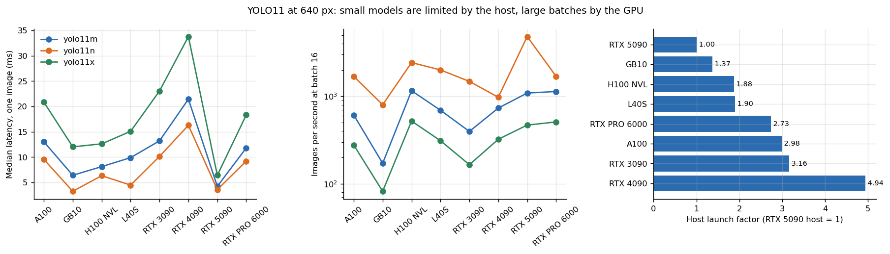
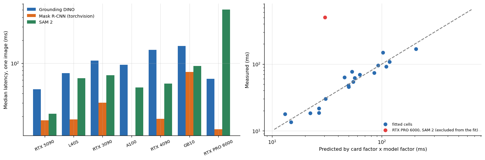

# Vision: detection, tracking and segmentation bench

**YOLO11, SAM 2, Grounding DINO, Mask R-CNN (and Detectron2 itself) timed on 8 GPU models, with the failures kept.** The goal was not a leaderboard of cards but an answer to a practical question: for a vision pipeline, what limits latency, what does batching buy, and which card is cheapest per image?



## Why this matters

Detection and segmentation models are small compared with language models, and that changes what you should buy. A GPU that is twice as fast in arithmetic can be *slower* for one image at a time, because a small network launches many tiny kernels and the **host** (CPU, driver, Python) issues them. This repository separates the two regimes with data: single-image latency (launch bound) and batch throughput (arithmetic bound), and fits a one-number model of each host.

## Headline results

| Finding | Evidence |
|---|---|
| Single-image latency of the nano model is **not** set by the GPU | RTX 5090 3.6 ms against RTX 4090 16.3 ms; the worst host (RTX 4090) is 4.9x slower at launching than the best |
| Batching changes the picture completely | Nano model on the 5090: 17x more images per second at batch 16 than at batch 1 |
| Large batches are arithmetic bound | Extra-large model at batch 16: H100 NVL 521 images/s against RTX 3090 165 |
| Cheapest YOLO11m (batch 16) | **RTX 4090**, US$ 0.16 per million images |
| SAM 2 ranges 4x across cards | 21.8 ms (RTX 5090) to 92.0 ms (ARM GB10) for one image and one point |
| A newer card can lose | Grounding DINO: RTX 4090 149 ms, RTX 3090 108 ms, RTX 5090 45 ms. The text-processing step runs on the host CPU |
| One measurement is wrong or unexplained | SAM 2 on one RTX PRO 6000 host: 506 ms, against 30 ms predicted for that card. Kept in the data and flagged, not averaged in |
| The stand-in is a floor | Detectron2 itself (real COCO images) took 51.1 ms for Mask R-CNN on an RTX 3090, 1.69x the torchvision stand-in on random noise (30.2 ms) |



## How to read the segmentation model

`analysis/segmentation.py` fits log(latency) = card factor + model factor on the cells of the table. The fit leaves a residual spread of 0.21 in logarithms (about 23%), so the card factors behave like a property of the machine as much as of the GPU. That is also why the one 16x outlier stands out so clearly in the right panel: it sits far off the line that the other 19 cells follow.

## What did not run

6 of 29 attempts failed (`results/tables/attempts_by_status.md`): Detectron2 failed to compile twice and to import once before it ran on an RTX 3090; SAM 2 failed twice at install (a source clone, a package index); Grounding DINO once at model download. All were environment or network problems, not limits of a card, and they are listed so the coverage of each cell is honest.

## Repository map

```
src/vision/   libs.py (YOLO, trackers, SAM 2, Grounding DINO, Mask R-CNN timing), gpu_suite.py (Detectron2 on real images)
analysis/     yolo.py, segmentation.py (+ benchkit.py: additive log fit)
data/         libs_runs.csv (every timed run), segmentation_attempts.csv (successes and failures)
results/      figures and tables
tests/        conclusions that must keep following from the data
```

## Reproduce

```bash
make setup && make all
python src/vision/libs.py yolo_gpu_only sam2 gdino maskrcnn_tv    # on a CUDA machine; each function records one JSON line per run
```

## Limits

Median of 10 to 30 timed calls after warm-up, one session per cell; hosts differ between sessions, so card factors include the host. Mask R-CNN in the main table is the torchvision implementation on random noise (a floor for real scenes). Tracking (ByteTrack, BoT-SORT) was timed for throughput only; no ground truth was available, so HOTA and IDF1 were **not** evaluated. Image quality of the masks and boxes was not scored.

## Articles that use this repository

- [YOLO11 on eight GPUs and a CPU-bound surprise](https://www.kaggle.com/code/lucasrangelss/yolo11-on-eight-gpus-and-a-cpu-bound-surprise)
- [SAM 2, Grounding DINO and Mask R-CNN latency](https://www.kaggle.com/code/lucasrangelss/sam-2-grounding-dino-and-mask-r-cnn-latency)
- [How many cameras can one RTX 5090 serve](https://www.kaggle.com/code/lucasrangelss/how-many-cameras-can-one-rtx-5090-serve): the multi-camera system built on these models, repository [multi-camera-rtsp-capacity](https://github.com/LucasRangelSSouza/multi-camera-rtsp-capacity)
- Harness and costs: [vast-gpu-benchmark-harness](https://github.com/LucasRangelSSouza/vast-gpu-benchmark-harness)

Licence: MIT for this code. Ultralytics is AGPL-3.0; SAM 2 and Detectron2 are Apache-2.0; see `LICENSE_NOTES.md`.
